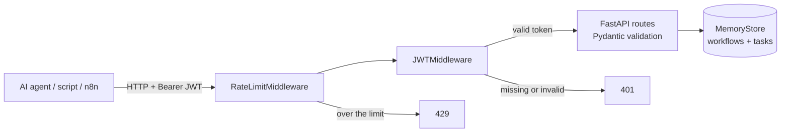

🌐 **English** | [Português (BR)](README.pt-BR.md)

# AI Agent FastAPI Service

[](https://github.com/PresetyX/ai-agent-fastapi-service/actions/workflows/ci.yml)


REST microservice in FastAPI to **register and track automation workflows and their
tasks**. It is the backend layer that an AI agent, a script or an integration (n8n, Make,
cron) uses to create a workflow, add steps, mark what has been completed and query the
state, with JWT authentication, rate limiting and input validation.

> The name comes from the project's origin: the first version of the code was generated with an
> AI agent and then reviewed, tested and fixed by hand. The service itself **does not call LLMs**: it
> is the state API that agents and automations consume.

## The problem

Automations and agents run multi-step processes: customer onboarding, invoice closing,
weekly reports. Without a central place to record those steps, it is hard to
know what has already run, what failed and what is missing, and each script ends up storing state
in its own way. This service offers a single, validated contract for that:

- **a workflow** represents the process (`draft` → `active` → `archived`);
- **tasks** inside it represent the steps, with a completion status;
- any authenticated client (agent, script or dashboard) reads and updates the same state over HTTP.

## Architecture



- **Pydantic v2:** validates sizes, status enums and UUIDs before reaching the route (422 on
  invalid input).
- **JWT (HS256):** all routes require `Authorization: Bearer <token>`, except `/health` and the
  documentation. Expired tokens or tokens signed with a different secret are rejected.
- **Rate limit:** sliding window per IP (default of 60 requests per minute).
- **Internal errors:** a global handler returns a generic `500`, without leaking a stack trace.
- **Storage:** in memory, behind a `MemoryStore` class with a small interface, which
  makes it easy to swap in PostgreSQL or Redis.

## Endpoints

| Method | Route | Description |
|---|---|---|
| `GET` | `/health` | Health check (public). |
| `POST` | `/workflows` | Creates a workflow. |
| `GET` | `/workflows` | Lists workflows with their tasks. |
| `GET` | `/workflows/{id}` | Shows a workflow. |
| `PATCH` | `/workflows/{id}` | Partial update (name, description, status). |
| `DELETE` | `/workflows/{id}` | Removes the workflow and its tasks. |
| `POST` | `/workflows/{id}/tasks` | Adds a task. |
| `GET` | `/workflows/{id}/tasks` | Lists the workflow's tasks. |
| `GET` | `/workflows/{id}/tasks/{task_id}` | Shows a task. |
| `PATCH` | `/workflows/{id}/tasks/{task_id}` | Updates a task (e.g. `completed: true`). |
| `DELETE` | `/workflows/{id}/tasks/{task_id}` | Removes a task. |

Interactive documentation (Swagger) is available at `/docs`.

## Quick start

### Docker

```bash
docker build -t ai-agent-fastapi-service .
docker run -p 8000:8000 -e JWT_SECRET="a-secret-with-at-least-32-bytes" ai-agent-fastapi-service
```

### Python

```bash
git clone https://github.com/PresetyX/ai-agent-fastapi-service.git
cd ai-agent-fastapi-service
python -m venv .venv && source .venv/bin/activate   # Windows: .venv\Scripts\activate
pip install -e ".[dev]"
export JWT_SECRET="a-secret-with-at-least-32-bytes"
uvicorn app.main:app --reload
```

### Usage example

```bash
# 1. Generate a development token (in production, it would come from your identity provider)
TOKEN=$(python -c "import jwt,os; print(jwt.encode({'sub':'reporting-agent'}, os.environ['JWT_SECRET'], algorithm='HS256'))")

# 2. Create the workflow
curl -s -X POST localhost:8000/workflows -H "Authorization: Bearer $TOKEN" \
  -H "Content-Type: application/json" -d '{"name": "Weekly report", "status": "active"}'

# 3. Register a step and mark it as completed
curl -s -X POST localhost:8000/workflows/<ID>/tasks -H "Authorization: Bearer $TOKEN" \
  -H "Content-Type: application/json" -d '{"title": "Collect metrics"}'
curl -s -X PATCH localhost:8000/workflows/<ID>/tasks/<TASK_ID> -H "Authorization: Bearer $TOKEN" \
  -H "Content-Type: application/json" -d '{"completed": true}'
```

## Tests

```bash
pytest --cov=app
```

13 tests, about 99% coverage: full CRUD cycle, partial update with
`updated_at`, validation (empty name, invalid status, maximum size, malformed UUID), 404 on
nonexistent resources, missing, invalid and expired tokens and tokens signed with a different secret,
public routes, and the rate limit returning `429` after the limit.

CI (GitHub Actions) runs `ruff` lint, the tests on Python 3.11 and 3.12 with a minimum coverage
of 90%, the Docker image build and a container smoke test.

## Configuration

| Variable | Default | Description |
|---|---|---|
| `JWT_SECRET` | development secret | HS256 key used to validate tokens. **Must be set in production** (32+ bytes). |
| `RATE_LIMIT_PER_MINUTE` | `60` | Requests per IP every 60 seconds. |

## Limitations and next steps

- Data lives in memory and is lost on restart; the next step is to persist it in
  PostgreSQL while keeping the `MemoryStore` interface.
- The rate limit is also in memory and applies per instance; with several replicas, it should use Redis.
- The service validates tokens but does not issue them. In production, issuing would be left to an identity
  provider.
- No scopes or per-resource permissions: any valid token can access all workflows.

## Development history

Developed locally between August 23 and November 17, 2026. The commit history was created afterwards, and the commit dates were adjusted to match the period in which the work was actually done.

## License

MIT.
