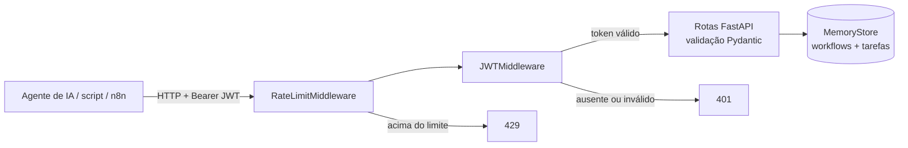

# AI Agent FastAPI Service

[](https://github.com/PresetyX/ai-agent-fastapi-service/actions/workflows/ci.yml)


Microsserviço REST em FastAPI para **registrar e acompanhar workflows de automação e suas
tarefas**. É a camada de backend que um agente de IA, um script ou uma integração (n8n, Make,
cron) usa para criar um workflow, adicionar etapas, marcar o que foi concluído e consultar o
estado, com autenticação JWT, rate limiting e validação de entrada.

> O nome vem da origem do projeto: a primeira versão do código foi gerada com um agente de IA
> e depois revisada, testada e corrigida manualmente. O serviço em si **não chama LLMs**: ele
> é a API de estado que agentes e automações consomem.

## O problema

Automações e agentes executam processos em várias etapas: onboarding de cliente, fechamento
de faturas, relatório semanal. Sem um lugar central para registrar essas etapas, fica difícil
saber o que já rodou, o que falhou e o que falta, e cada script acaba guardando o estado do
seu jeito. Este serviço oferece um contrato único e validado para isso:

- **um workflow** representa o processo (`draft` → `active` → `archived`);
- **tarefas** dentro dele representam as etapas, com status de conclusão;
- qualquer cliente autenticado (agente, script ou painel) lê e atualiza o mesmo estado via HTTP.

## Arquitetura



- **Pydantic v2:** valida tamanhos, enums de status e UUIDs antes de chegar à rota (422 em
  entrada inválida).
- **JWT (HS256):** todas as rotas exigem `Authorization: Bearer <token>`, exceto `/health` e a
  documentação. Tokens expirados ou assinados com outro segredo são rejeitados.
- **Rate limit:** janela deslizante por IP (padrão de 60 requisições por minuto).
- **Erros internos:** um handler global devolve `500` genérico, sem vazar stack trace.
- **Armazenamento:** em memória, atrás de uma classe `MemoryStore` com interface pequena, o
  que facilita trocar por PostgreSQL ou Redis.

## Endpoints

| Método | Rota | Descrição |
|---|---|---|
| `GET` | `/health` | Health check (público). |
| `POST` | `/workflows` | Cria um workflow. |
| `GET` | `/workflows` | Lista workflows com suas tarefas. |
| `GET` | `/workflows/{id}` | Detalha um workflow. |
| `PATCH` | `/workflows/{id}` | Atualização parcial (nome, descrição, status). |
| `DELETE` | `/workflows/{id}` | Remove o workflow e suas tarefas. |
| `POST` | `/workflows/{id}/tasks` | Adiciona uma tarefa. |
| `GET` | `/workflows/{id}/tasks` | Lista as tarefas do workflow. |
| `GET` | `/workflows/{id}/tasks/{task_id}` | Detalha uma tarefa. |
| `PATCH` | `/workflows/{id}/tasks/{task_id}` | Atualiza uma tarefa (ex.: `completed: true`). |
| `DELETE` | `/workflows/{id}/tasks/{task_id}` | Remove uma tarefa. |

A documentação interativa (Swagger) fica em `/docs`.

## Execução rápida

### Docker

```bash
docker build -t ai-agent-fastapi-service .
docker run -p 8000:8000 -e JWT_SECRET="um-segredo-com-pelo-menos-32-bytes" ai-agent-fastapi-service
```

### Python

```bash
git clone https://github.com/PresetyX/ai-agent-fastapi-service.git
cd ai-agent-fastapi-service
python -m venv .venv && source .venv/bin/activate   # Windows: .venv\Scripts\activate
pip install -e ".[dev]"
export JWT_SECRET="um-segredo-com-pelo-menos-32-bytes"
uvicorn app.main:app --reload
```

### Exemplo de uso

```bash
# 1. Gerar um token de desenvolvimento (em produção, ele viria do seu provedor de identidade)
TOKEN=$(python -c "import jwt,os; print(jwt.encode({'sub':'agente-relatorios'}, os.environ['JWT_SECRET'], algorithm='HS256'))")

# 2. Criar o workflow
curl -s -X POST localhost:8000/workflows -H "Authorization: Bearer $TOKEN" \
  -H "Content-Type: application/json" -d '{"name": "Relatório semanal", "status": "active"}'

# 3. Registrar uma etapa e marcá-la como concluída
curl -s -X POST localhost:8000/workflows/<ID>/tasks -H "Authorization: Bearer $TOKEN" \
  -H "Content-Type: application/json" -d '{"title": "Coletar métricas"}'
curl -s -X PATCH localhost:8000/workflows/<ID>/tasks/<TASK_ID> -H "Authorization: Bearer $TOKEN" \
  -H "Content-Type: application/json" -d '{"completed": true}'
```

## Testes

```bash
pytest --cov=app
```

13 testes, cerca de 99% de cobertura: ciclo CRUD completo, atualização parcial com
`updated_at`, validação (nome vazio, status inválido, tamanho máximo, UUID malformado), 404 em
recursos inexistentes, token ausente, inválido, expirado e assinado com outro segredo,
rotas públicas e rate limit retornando `429` após o limite.

O CI (GitHub Actions) roda lint com `ruff`, os testes em Python 3.11 e 3.12 com cobertura
mínima de 90%, o build da imagem Docker e um smoke test do container.

## Configuração

| Variável | Padrão | Descrição |
|---|---|---|
| `JWT_SECRET` | segredo de desenvolvimento | Chave HS256 para validar os tokens. **Obrigatório definir em produção** (32+ bytes). |
| `RATE_LIMIT_PER_MINUTE` | `60` | Requisições por IP a cada 60 segundos. |

## Limitações e próximos passos

- Os dados ficam em memória e se perdem ao reiniciar; o próximo passo é persistir em
  PostgreSQL mantendo a interface do `MemoryStore`.
- O rate limit também é em memória e vale por instância; com várias réplicas, deveria usar Redis.
- O serviço valida tokens, mas não os emite. Em produção, a emissão ficaria com um provedor
  de identidade.
- Sem escopos ou permissões por recurso: qualquer token válido acessa todos os workflows.

## Licença

MIT.
